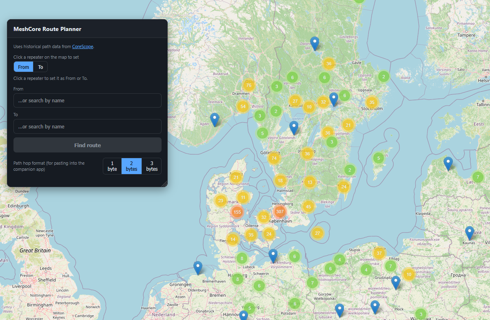
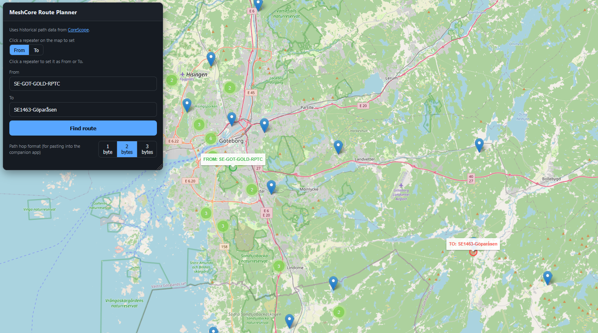
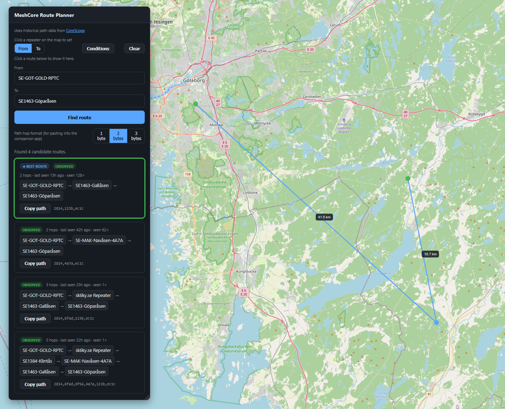
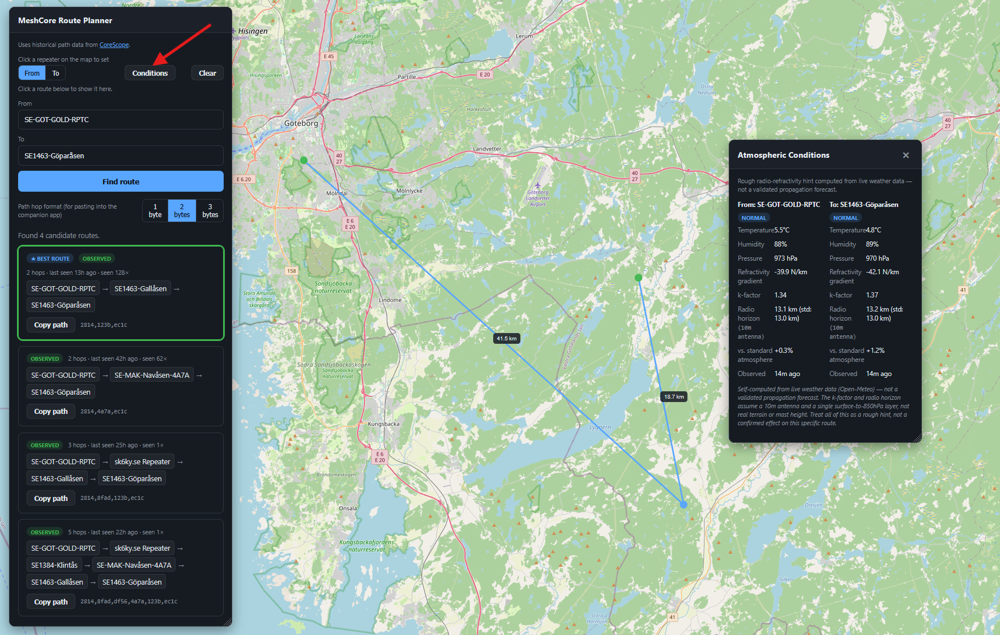

# MeshRoutePlanner

A small web app for planning radio routes on a [MeshCore](https://meshcore.co.uk/) LoRa mesh network.

It uses historical path and node data from [CoreScope](https://meshcore.meshat.se) — a public, open-source project that passively records real MeshCore traffic sniffed off the air — to find one or more plausible routes between two nodes. It mirrors the manual technique of tracing backward from a destination node's "Paths Through This Node" history toward an origin, instead of doing that lookup by hand.

A found route can be exported as a comma-separated hex-prefix string, ready to paste into the MeshCore companion app's custom routing path field.

## Screenshots

| Overview map | Pick From / To | Route results | Conditions (experimental) |
|---|---|---|---|
|  |  |  |  |

## Features

- **Map-first picker** — all known repeaters are plotted on a map on load; click one as "From" and another as "To", or search by name.
- **Route finder** — backward search over CoreScope's recorded paths, with three confidence tiers:
  - **Observed** — a literal path CoreScope has actually seen carry traffic end-to-end.
  - **Stitched** — pieced together from overlapping observed path fragments.
  - **Computed** — a fallback based on pairwise neighbor-link ("reach") data when no historical path exists at all.
- **Best route highlight** plus alternative candidates, each showing recency and observation count.
- **Copy path** — exports the full hop chain (origin through destination) as 1/2/3-byte hex prefixes for the MeshCore companion app.
- **Node info popup** — click a hop or map marker to see name, role, public key, coordinates, first/last seen, and a link to the node's CoreScope page.
- **Cancellable search** — a Stop button aborts an in-progress route search, client and server side.
- **Atmospheric conditions (experimental)** — a movable "Conditions" panel showing live weather for the From/To nodes, converted into a rough radio-refractivity hint: a ducting-likelihood badge and an effective k-factor / radio horizon estimate vs. the standard atmosphere. This is self-computed from free weather data, not a validated propagation forecast — treat it as a rough, experimental hint, not a confirmed effect on any specific route.
- Server-side caching of CoreScope API calls to stay gentle on the third-party API.

## Prerequisites

- [.NET 9 SDK](https://dotnet.microsoft.com/download/dotnet/9.0)
- Internet access (the server calls `meshcore.meshat.se` on your behalf — the API has no CORS headers, so this can't be done from the browser directly)

## Running

```bash
cd MeshRoutePlanner.Web
dotnet run
```

Then open the URL printed in the console (e.g. `http://localhost:5299`) in a browser.

### Running in Docker

```bash
docker compose up --build
```

or without compose:

```bash
docker build -t meshrouteplanner .
docker run -p 8080:8080 meshrouteplanner
```

Then open `http://localhost:8080`.

## Project structure

- `MeshRoutePlanner.Core` — class library: CoreScope API client, models, and the route-finding algorithm.
- `MeshRoutePlanner.Web` — ASP.NET Core minimal API host + static frontend (`wwwroot/`, vanilla JS/HTML/CSS, Leaflet.js for the map).

## Data source

All node and path data comes from [CoreScope](https://github.com/Kpa-clawbot/CoreScope)'s public read-only API. No private user data is involved — only public repeater/node metadata (names, public keys, coordinates, path histories) that CoreScope itself exposes.

## Status

Personal project, step 1 of 2 (a CLI variant is a possible future step 2).
